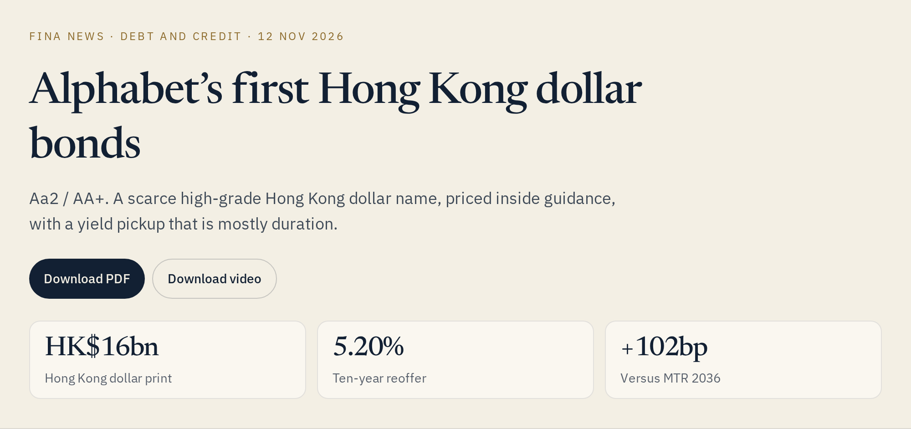
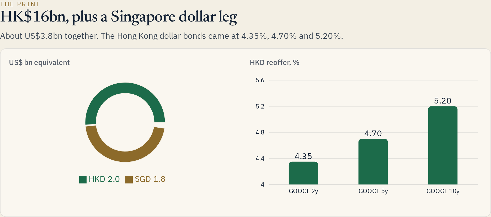
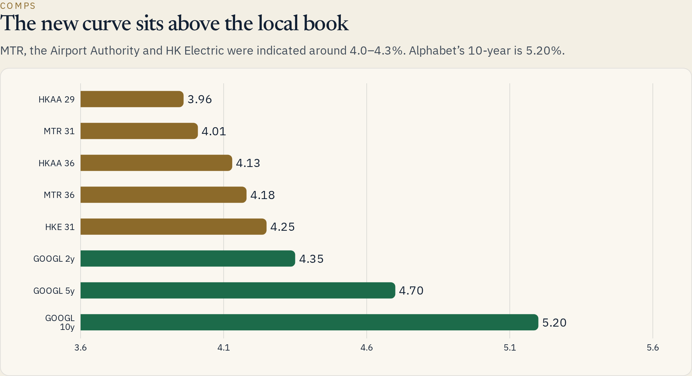
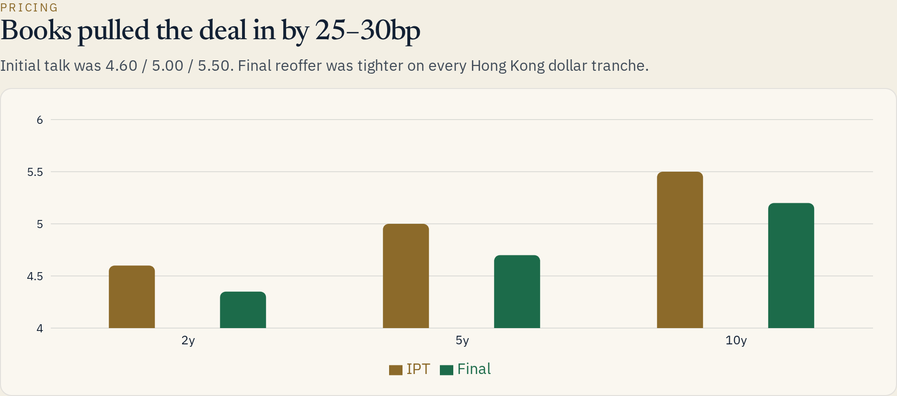
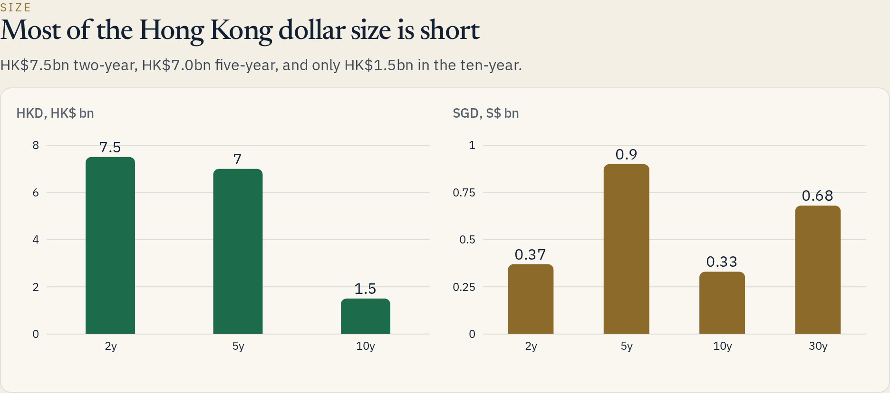
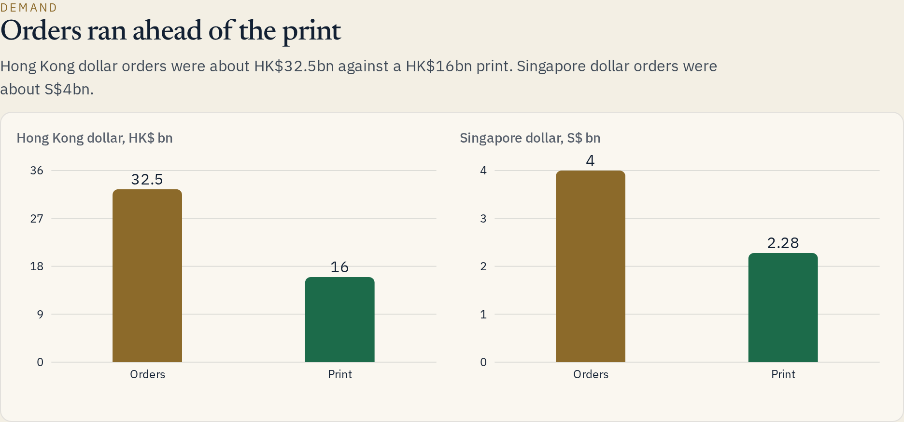
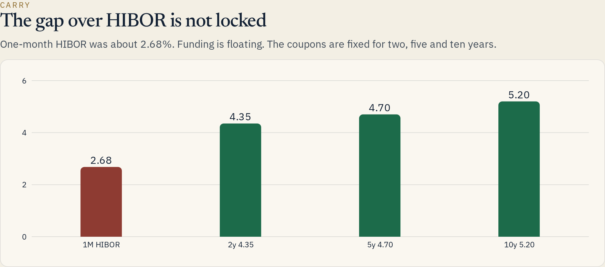
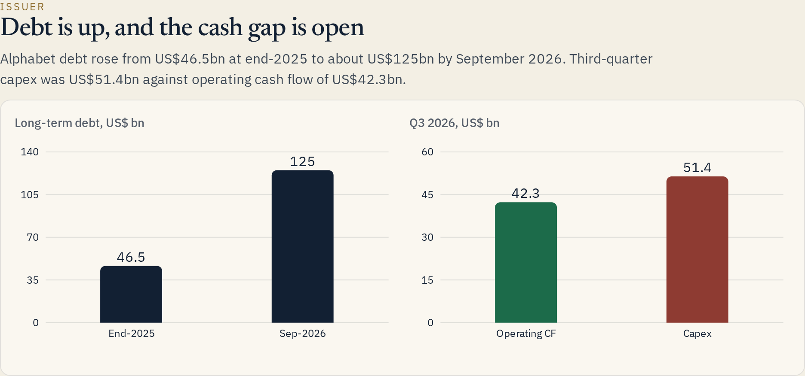
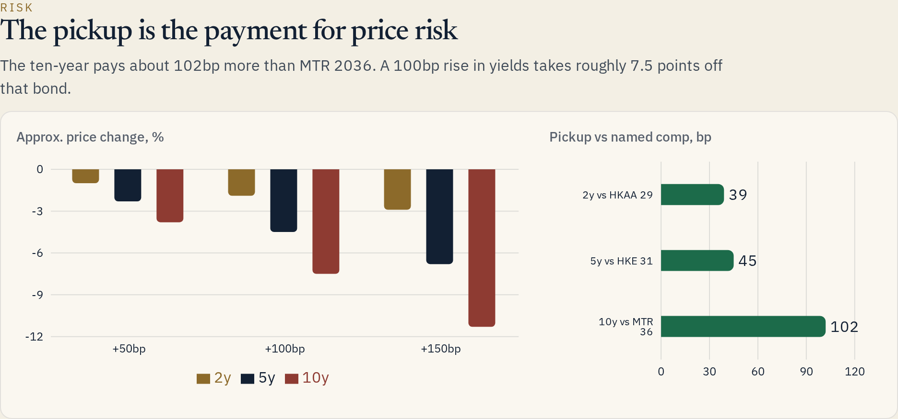

# Alphabet’s first Hong Kong dollar bonds

FINA news · 12 November 2026 · Aa2 / AA+

**Play the two-minute briefing (with narration):** [briefing.mp4](public/briefing.mp4)

[PDF of the charts](public/alphabet-hkd-brief.pdf)

Figures follow reported term sheets and secondary Hong Kong dollar indications around the launch. Duration moves on the last chart are approximate.
